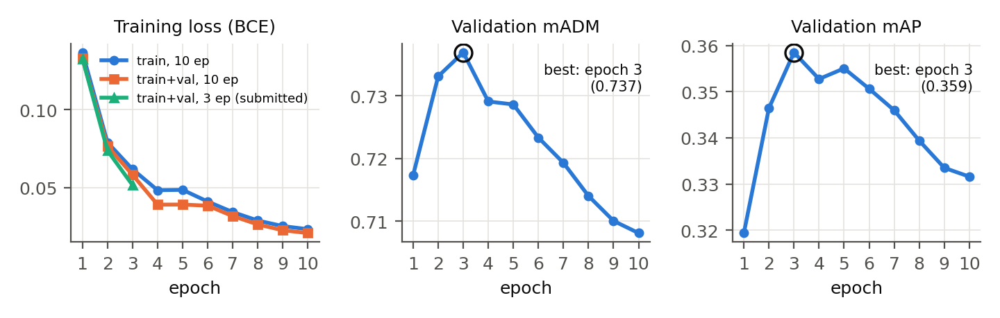

# Attribute-Based Person Retrieval with a Fine-Tuned CLIP ViT

Our entry to **Track 2 of the UPAR Challenge 2027** (Attribute-Based Person Retrieval), held at the
[Real-World Surveillance: Applications and Challenges workshop (RWS) @ WACV 2027](https://vap.aau.dk/rws/challenge/).

**Team:** Arsh Al Aman (23K-0078) · Rao Ghulam Mohiuddin (23K-0001) · Sheikh Naveed Azeemi (23K-0003)  
**Course:** Computer Vision, FAST National University of Computer and Emerging Sciences · Instructor: Mr. Syed Bilal Ahsan  
**Codabench team:** `arshalaman` · **Final result: 0.624 mADM on the hidden test set, rank 32**
**Leaderboard:** [Codabench Track 2 results](https://www.codabench.org/competitions/18196/#/results-tab)

| Report | Slides | Proof of submission |
|---|---|---|
| [`report/UPAR_Track2_Report.pdf`](report/UPAR_Track2_Report.pdf) | [`report/UPAR_Track2_Demo.pptx`](report/UPAR_Track2_Demo.pptx) | [`report/proof_of_submission/`](report/proof_of_submission/) |

---

## 1. The task

A query is **not an image but a description**: a vector of 40 binary attributes (age, gender, hair length,
upper and lower clothing length, type and colour, and accessories), for example

> adult · female · long hair · red short-sleeved top · black trousers · backpack

For every query, the system ranks a gallery of pedestrian crops so that the people matching the
description come first.

- **Domain shift:** the test gallery comes from cameras that are never seen during training.
- **Metric:** mean Average Degree of Match (**mADM**). It works like mAP but gives partial credit to near
  misses: an image that differs from the query in one attribute is better than one that differs in twenty.
- **Code submission:** `run.py` runs on an NVIDIA A10 with no internet, only plain PyTorch, and a 5-minute
  limit.
- **Data:** 97,669 training and 33,407 validation crops from PA-100K, PETA and Market-1501, with 3,462
  validation queries.

## 2. Our approach

```
gallery crop ──► CLIP ViT-B/16 (fine-tuned) ──► 40 attribute probabilities ──► likelihood scoring ──► ranked gallery
  256×128          + flip TTA, 2-model ensemble                                   vs. every query
```

**Attribute recogniser**
- Visual tower of OpenAI **CLIP ViT-B/16**. General foundation models are allowed by the rules.
- Input 256×128. The 14×14 position grid is resampled to 16×8 for tall pedestrian crops.
- Head: [class token ; mean patch token] → LayerNorm → Linear(40).
- Re-implemented in plain PyTorch (`upar_model.py`), because the evaluation container has no `open_clip`.
  It reproduces `open_clip` outputs exactly (max diff 0.0).

**Training**
- BCE loss (unweighted, so the probabilities stay calibrated) and AdamW with layer-wise learning-rate decay
  0.75, cosine schedule and EMA weights.
- Augmentations chosen for surveillance footage:
  - a **low-resolution simulation** for distant cameras
  - flip and scale/shift
  - brightness/contrast jitter
  - small random erasing
  - **no hue jitter**, because colour is a label
- **3 epochs.** Validation peaks there, and longer training overfits the source datasets (see results).

**Retrieval scoring**

The starter kit ranks by the L1 distance Σ|q − p|, which treats a confident mistake like an uncertain one.
We score by the log-likelihood that an image shows exactly the query, plus an agreement term for near misses:

```
s(q, g) = Σk [ qk·log p̂k + (1−qk)·log(1−p̂k) ]  +  α · Σk [ qk·pk + (1−qk)·(1−pk) ]
s'(q, g) = s + β · log_softmax_over_queries(s / τ)
```

Each gallery image matches exactly one query, so the query-side normalisation pushes down images that fit
many queries equally well. α = 1, β = 2, τ = 10 and ε = 1e-3 were tuned on the validation split. The
setting is stable: neighbouring values score within 0.0004.

**Final submission**

The final submission averages the predictions of two models: one trained on *train* only, and one trained
on *train + val*, both for 3 epochs.

## 3. Results

**Validation scoring ablation** (same attribute model; 33,407 images × 3,462 queries)

| Method | mADM | mAP | Rank-1 |
|---|---|---|---|
| Organiser baseline (attribute prior + L1) | 0.113 | 0.001 | 0.000 |
| Our CLIP model + L1 distance | 0.694 | 0.233 | 0.279 |
| + log-likelihood scoring | 0.735 | 0.360 | 0.365 |
| **+ agreement term + query normalisation (ours)** | **0.746** | 0.340 | 0.351 |

**Hidden test set** ([Codabench leaderboard](https://www.codabench.org/competitions/18196/#/results-tab))

| Submission | mADM | mAP | Rank-1 | Rank-5 | Rank-10 | mINP |
|---|---|---|---|---|---|---|
| Train only, 3 epochs | 0.619 | 0.348 | 0.378 | 0.571 | 0.653 | 0.250 |
| Train + val, 3 epochs | 0.613 | 0.339 | 0.359 | 0.564 | 0.652 | 0.241 |
| **Ensemble of both (final, rank 32)** | **0.624** | **0.353** | **0.385** | **0.575** | **0.658** | **0.252** |
| Winner, for reference | 0.699 | 0.416 | 0.397 | 0.560 | 0.632 | 0.292 |

As a by-product, the same model scores mA 0.831, instance-F1 0.893 and a Track 1 challenge average of
0.861 on the validation split.

**Findings**
- **More training hurts under domain shift.** Validation mADM peaks at 0.737 after 3 epochs and falls to
  0.708 by epoch 10, while the training loss keeps falling.
- **The scoring is robust.** Under simulated shift (noisy, over-confident or prior-shifted probabilities),
  our scoring stayed ahead of L1 in every case (`analysis.py`). The test gap therefore comes from the
  attribute model, not the ranking.
- **More source data alone did not help** (0.613 vs. 0.619), but **averaging the two models improved every
  metric**.
- **Rare attributes are the weak spot.** Sunglasses, "other" colours and colours with under 2% positives
  reach only about 60–70% balanced accuracy.

<p align="center"></p>

## 4. Repository structure

```
.
├── README.md
├── report/
│   ├── UPAR_Track2_Report.pdf / .docx     full report (7 pages)
│   ├── UPAR_Track2_Demo.pptx              demo slides
│   ├── Task_and_Approach.md               short task and approach description
│   ├── figures/                           training curves, ablation, per-attribute accuracy
│   └── proof_of_submission/               Codabench screenshots
├── runs/                                  experiment logs (weights are not in git)
│   ├── dev/      train only, 10 epochs, validated every epoch (log, results, tuned scoring)
│   ├── final/    train+val, 10 epochs (not submitted: overfitted)
│   ├── final3/   train+val, 3 epochs
│   └── ablation.json
└── UPAR-Challenge-2027-main/              official starter kit (annotations, download script, example)
    └── solution/                          ← our code
        ├── upar_model.py        CLIP ViT in plain PyTorch + attribute head
        ├── retrieval.py         scoring + re-implementation of mADM / mAP / Rank-k / mINP
        ├── prepare_cache.py     resizes all images once into a ~1 GB JPEG cache
        ├── data.py              dataset + GPU augmentations
        ├── train.py             training (resumable, per-epoch checkpoints)
        ├── evaluate.py          validation metrics + scoring grid search → scoring.json
        ├── analysis.py          report figures, ablation, domain-shift robustness check
        ├── build_submission.py  builds the Codabench zip (one or more models)
        ├── fetch_clip.py        exports the OpenAI CLIP visual weights
        ├── submission_src/run.py  the code Codabench executes
        └── colab_train.ipynb    the full pipeline on Google Colab
```

## 5. How to reproduce

**On Google Colab (what we used; one T4 GPU)**
1. Upload this repository folder to Google Drive.
2. Open `UPAR-Challenge-2027-main/solution/colab_train.ipynb` in Colab and choose a T4 GPU.
3. Run the cells in order:
   1. Download the data (~15 min) and build the cache (~10 min).
   2. Fetch the CLIP weights.
   3. Development run on *train*, validated every epoch (~2 h).
   4. `evaluate.py` to tune the scoring.
   5. Final 3-epoch run on *train + val* (~45 min).
   6. Build the ensemble zip.

   Everything is saved to Drive, and training resumes after a disconnect.

**Locally (GPU), from `UPAR-Challenge-2027-main/`**
```bash
python download_datasets.py --data-dir ./data
cd solution
pip install open_clip_torch && python fetch_clip.py --arch ViT-B-16
python prepare_cache.py --data-root ../data --out cache
python train.py --cache cache --train-splits train --val-split val --epochs 10 --out runs/dev
python evaluate.py --ckpt runs/dev/model_best.pt --cache cache --out runs/dev
python train.py --cache cache --train-splits train val --epochs 3 --out runs/final3
python build_submission.py --ckpt runs/final3/model_ema.pt runs/dev/model_best.pt \
       --scoring runs/dev/scoring.json --out upar_t2_ensemble.zip
```

**Regenerate the report figures and tables (CPU only)**
```bash
cd UPAR-Challenge-2027-main/solution
python analysis.py --runs ../../runs --out ../../report/figures
```

The trained weights (~170 MB each) are not stored in git.

## 6. Challenges we faced

- **Domain shift:** the hidden test cameras are unseen, so the number of epochs turned out to be the most
  important regulariser.
- **A hidden 4.5× slowdown:** PyTorch reports bfloat16 as supported on the T4, but it is emulated there
  (≈30 vs. 139 img/s). We fixed it by checking the GPU's compute capability and using fp16.
- **Free-GPU quotas:** Colab cut sessions mid-run, so training saves per-epoch checkpoints to Drive and
  resumes automatically.
- **Offline code submission:** only plain PyTorch is available, with a 5-minute limit. CLIP was
  re-implemented and the zip was tested exactly as the ingestion program calls it.

## 7. Possible improvements

- Ensembles of more seeds or larger backbones (ViT-L/14) within the time budget.
- Softmax heads for mutually exclusive groups (age, colours) instead of assuming independent attributes.
- A class-balanced or focal loss with re-calibration for rare attributes.
- A retrieval-aware (listwise) training objective.

## References

1. A. Specker, M. Cormier, J. Beyerer. *UPAR: Unified Pedestrian Attribute Recognition and Person Retrieval.* WACV 2023.
2. M. Cormier et al. *UPAR Challenge 2024: Pedestrian Attribute Recognition and Attribute-Based Person Retrieval – Dataset, Design, and Results.* WACV Workshops 2024.
3. A. Radford et al. *Learning Transferable Visual Models From Natural Language Supervision (CLIP).* ICML 2021.
4. A. Specker, J. Beyerer. *Balanced Pedestrian Attribute Recognition for Improved Attribute-based Person Retrieval.* 2023.

The `UPAR-Challenge-2027-main/` starter kit and annotations are provided by the challenge organisers under
CC BY-NC-SA 3.0. The source datasets (PA-100K, PETA, Market-1501) keep their own licences.
